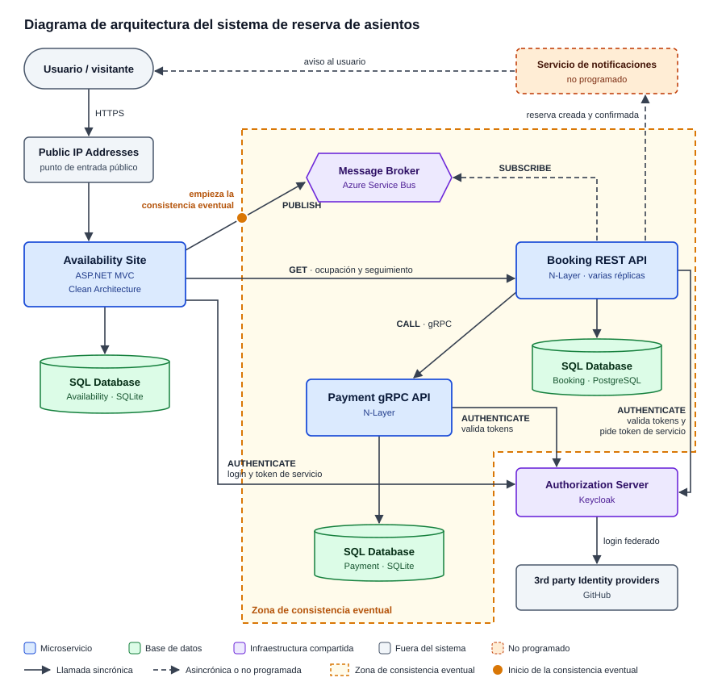
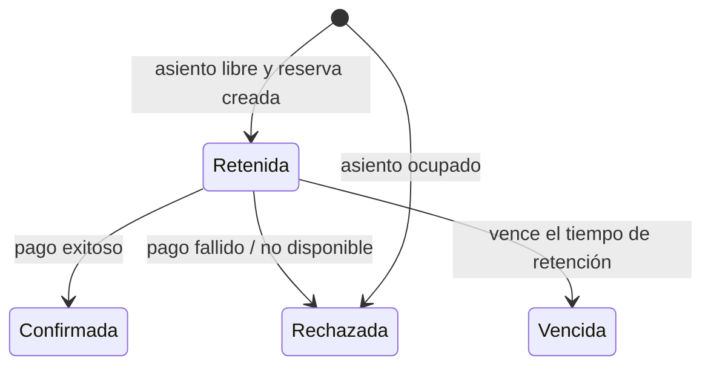

# Arquitectura del sistema

## 1. Objetivo

El sistema utiliza una arquitectura de microservicios. Las responsabilidades del dominio se distribuyen entre servicios independientes que se comunican mediante mecanismos sincrónicos y asincrónicos.

La separación permite que cada componente tenga una responsabilidad definida y que el procesamiento de una solicitud de reserva no dependa de mantener una única operación sincrónica desde el navegador hasta el resultado del pago.

## 2. Diagrama de arquitectura y tabla de interpretación

El diagrama sigue el del enunciado, con los mismos componentes y conexiones (`PUBLISH`, `SUBSCRIBE`, `GET`, `CALL` y `AUTHENTICATE`). Debajo de cada nombre se indica la tecnología que usa el grupo. Se agregan el servicio de notificaciones (punto 3.h) y la zona donde el sistema se vuelve eventualmente consistente (punto 3.g).

**Cómo leer el diagrama:**
- **Colores:** azul para los microservicios, verde para la base propia de cada uno, violeta para la infraestructura compartida (broker y Keycloak), gris para lo que está fuera del sistema y naranja punteado para el servicio de notificaciones, que no está programado.
- **Flechas:** las continuas son llamadas sincrónicas, donde el que llama espera la respuesta. Las punteadas son la suscripción al broker (`SUBSCRIBE`) y el aviso de notificaciones.
- **Punto naranja en `PUBLISH`:** ahí empieza la consistencia eventual. Availability responde "solicitud recibida" en cuanto publica en el broker, antes de que Booking procese la solicitud.
- **Marco naranja:** lo que ocurre después de esa respuesta. Booking retiene o rechaza el asiento, Payment cobra y Booking confirma o rechaza. Payment está adentro porque Booking y Payment tienen bases separadas y no confirman en una sola transacción: por un momento, Payment puede tener el pago aprobado mientras la reserva sigue retenida. Durante ese intervalo, el seguimiento muestra "en proceso", y el estado se vuelve consistente cuando Booking guarda el resultado del pago (ver sección 5).

El diagrama es un SVG dibujado a mano para que se vea igual en cualquier lugar. Para corregirlo, se edita [`docs/diagramas/arquitectura-general.svg`](../diagramas/arquitectura-general.svg).

### Tabla de interpretación

| Componente | Rol | Justifique la participación en el sistema |
|---|---|---|
| **Usuario / visitante** | Actor externo que usa el sistema | Consulta los asientos sin iniciar sesión, inicia sesión para reservar, envía la solicitud de reserva y consulta su resultado en Availability. Es quien recibiría el aviso del servicio de notificaciones. |
| **Public IP Addresses** | Punto de entrada público al sistema | Cualquier visitante tiene que poder consultar los asientos de un evento sin iniciar sesión. En el diagrama, solo el sitio Availability está expuesto a Internet. Booking y Payment se llaman únicamente entre servicios, lo que reduce la superficie de ataque. |
| **Availability Site** | Sitio web (MVC) de cara al usuario | Muestra los asientos disponibles, verifica que el asiento exista, registra la solicitud con un identificador único, la publica en el broker y responde de inmediato que fue recibida, sin esperar el resultado; en el diagrama es la flecha PUBLISH. Después consulta a Booking el resultado de la reserva con un GET por REST. Inicia el login de los usuarios contra el Authorization Server y pide un token de servicio para llamar a Booking (AUTHENTICATE). |
| **Message Broker** | Intermediario de mensajería asincrónica (publicación y suscripción) | Desacopla Availability de Booking: Availability publica la solicitud (PUBLISH) y una de las réplicas de Booking, suscripta al broker (SUBSCRIBE), la toma. Absorbe los picos cuando muchas personas intentan reservar el mismo asiento, permite varias réplicas de Booking y conserva los mensajes si Booking cae un momento. Es el punto donde el sistema pasa a ser eventualmente consistente. |
| **Booking REST API** | Servicio dueño de las reservas y sus estados (Retenida, Confirmada, Rechazada, Vencida) | Se suscribe al broker (SUBSCRIBE), consume los mensajes y decide si el asiento está libre (crea una reserva retenida) o ocupado (la rechaza). Llama a Payment por gRPC (CALL) para cobrar, confirma o rechaza según la respuesta, expone el resultado por REST para el seguimiento (el GET de Availability) y vence las reservas retenidas. Valida los tokens que le llegan de Availability y pide uno para llamar a Payment (AUTHENTICATE). Al concentrar la regla "ocupado = retenida o confirmada" evita la doble reserva. |
| **Payment gRPC API** | Servicio de cobro | Booking lo llama por gRPC (CALL) para cobrar la reserva retenida y recibe el resultado. Aísla la lógica de cobro del resto del sistema, y si Payment no responde, Booking rechaza la reserva con pago no disponible. Usa gRPC porque es una llamada interna, sincrónica, eficiente y con contrato tipado. Valida la firma de los tokens que le llegan con las claves públicas del Authorization Server (AUTHENTICATE), sin consultarlo en cada llamada. No pide tokens propios. |
| **SQL Database (una por servicio)** | Persistencia propia de cada microservicio | El diagrama muestra tres bases, una junto a Availability, Booking y Payment. Cada servicio es dueño de sus datos: Availability guarda eventos, asientos y solicitudes, Booking las reservas y Payment los pagos. No se comparte base entre servicios, así cada uno evoluciona y escala por separado, y la coherencia entre ellos es eventual. |
| **Authorization Server (Keycloak)** | Emisor centralizado de identidad y tokens | Los tres servicios se conectan con él (flechas AUTHENTICATE): el usuario obtiene un token para reservar y los microservicios se autentican entre sí. Las APIs validan firma, emisor, audiencia y vencimiento de cada token. La seguridad queda en un solo lugar, en vez de que cada servicio maneje usuarios y contraseñas. |
| **3rd party Identity providers** | Proveedores de identidad externos federados con el Authorization Server | Permiten iniciar sesión con una cuenta ya existente (en nuestro caso GitHub), sin que el sistema guarde contraseñas. El Authorization Server delega la autenticación en ellos y emite su propio token para el resto de los servicios. |
| **Servicio de notificaciones** (no programado) | Servicio que informa al usuario el resultado de su reserva | Como Availability responde antes de conocer el resultado, avisa al usuario cuando la reserva queda creada y confirmada después de un pago exitoso, sin que tenga que entrar al seguimiento. Booking lo dispararía al confirmar la reserva, con el `usuarioId` que viaja en el mensaje. Se agrega por el punto 3.h del enunciado y no se programa. |

## 3. Responsabilidad de cada componente

### Availability

Es el punto de entrada para consultar disponibilidad, solicitar una reserva y consultar el resultado de una solicitud. Al recibir una solicitud, verifica la existencia del asiento, genera un identificador único, guarda la solicitud y publica un mensaje en el broker. Responde sin esperar a que Booking la procese. Si el broker no confirma la publicación, la solicitud queda guardada como pendiente de envío y Availability la reenvía en segundo plano.

El enunciado requiere que este servicio siga Clean Architecture y utilice un dominio anémico. La estructura concreta de capas se describe en [`../Microservicios/Availability.md`](../Microservicios/Availability.md).

### Booking

Consume los mensajes publicados por Availability. Verifica si el asiento está libre y, si lo está, crea una reserva retenida. Si el asiento ya está ocupado, rechaza la solicitud. Luego coordina el cobro con Payment y actualiza el estado de la reserva según el resultado.

El enunciado requiere una REST API, arquitectura N-Layer y dominio anémico. La estructura concreta de capas se describe en [`../Microservicios/Booking.md`](../Microservicios/Booking.md).

### Payment

Expone una API gRPC para que Booking solicite el procesamiento de un pago. Su responsabilidad es procesar la solicitud de pago y devolver un resultado que Booking pueda utilizar para confirmar o rechazar la reserva.

El enunciado requiere una API gRPC, arquitectura N-Layer y dominio anémico. La estructura concreta de capas se describe en `../docs/diagrams/Payment.md`.

### Broker

Transporta la solicitud de reserva desde Availability hasta Booking. Desacopla el momento en que se recibe la solicitud del momento en que se procesa.

**Rol concreto:** Availability la registra y la publica en el tópico `grupo7-booking-topic`; Booking la consume de su suscripción con peek-lock, un mensaje por vez y confirmación manual. El mensaje lleva cinco campos y el `solicitudId` como identificador de la traza.

**Justificación:** separa el momento de la recepción del momento de la resolución. Si Availability no logra publicar, la solicitud queda pendiente de envío y se reenvía en segundo plano (issue #92). Si Booking no está disponible, el mensaje espera en la entidad (TTL de 14 días). Si Payment no responde, el mensaje no se completa y se reentrega. La clave única por `solicitudId` evita reservas y cobros duplicados con reenvíos o réplicas simultáneas. La configuración y los valores reales están en `contracts/broker-config.md` (PR #86).

### Servidor de autorización

Permite obtener tokens y autenticar las comunicaciones que requieren autorización. El enunciado establece que los microservicios deben autenticarse entre sí con este servidor.

### Notifications

Informa al usuario cuando la reserva se encuentra creada y confirmada luego de que el pago se realizó exitosamente. El mecanismo técnico de envío debe completarse según la implementación.

## 4. Estados y ciclo de vida de una reserva

- **Retenida:** el asiento está apartado temporalmente mientras se procesa el pago.
- **Confirmada:** el pago fue exitoso; el asiento queda reservado.
- **Rechazada:** la reserva no se concretó. Debe registrarse el motivo.
- **Vencida:** se agotó el tiempo de retención sin un resultado de pago.

Un asiento está ocupado mientras exista una reserva retenida o confirmada. En cualquier otro estado vuelve a estar disponible.

## 5. Consistencia eventual

La consistencia eventual aparece porque Availability confirma la recepción de una solicitud antes de que Booking termine de procesarla y antes de que Payment determine el resultado del cobro.

Por lo tanto, durante un intervalo puede existir una solicitud aceptada por Availability cuyo resultado todavía no sea conocido por el usuario. El estado definitivo se obtiene luego de que Booking procesa el mensaje, coordina el pago y actualiza la reserva.

En el diagrama, el tramo asincrónico relevante es: Availability → Broker → Booking → Payment

La consulta posterior del usuario permite conocer el resultado actualizado. Los tiempos de reintento, las garantías de entrega, la deduplicación y el manejo de mensajes fallidos deben describirse de acuerdo con lo que efectivamente implemente el grupo.

## 6. Decisiones arquitectónicas

- Arquitectura general basada en microservicios.
- Availability implementado con Clean Architecture.
- Booking y Payment implementados con arquitectura N-Layer.
- Dominio anémico en los tres servicios indicados.
- Comunicación asincrónica mediante un broker para las solicitudes de reserva.
- Comunicación gRPC entre Booking y Payment.
- Autenticación entre microservicios mediante el servidor de autorización.
- Logs de auditoría para identificar el inicio y el fin de una cadena de sucesos en cada microservicio.
- Servicio de notificaciones para comunicar la confirmación al usuario.
