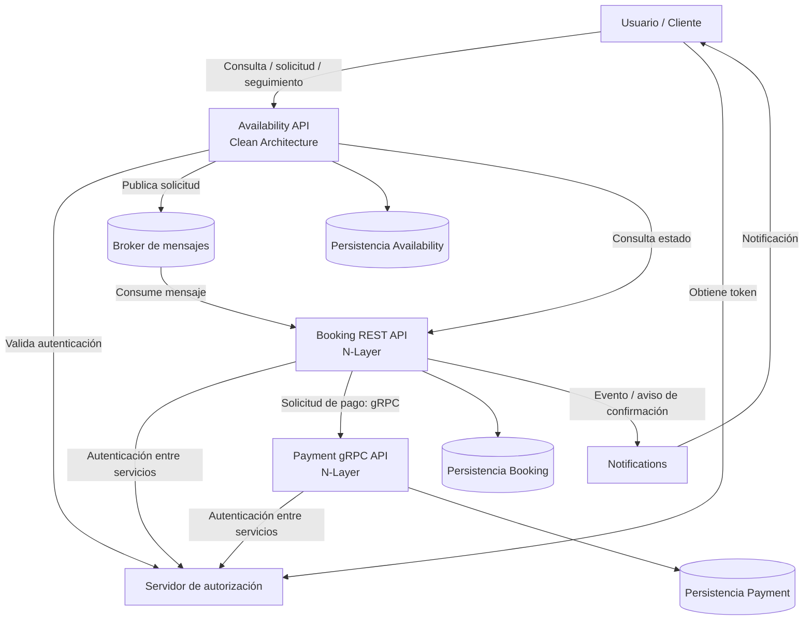
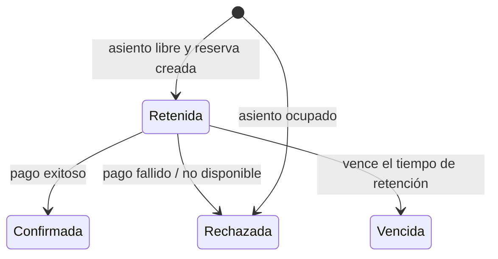

# Arquitectura del sistema

## 1. Objetivo

El sistema utiliza una arquitectura de microservicios. Las responsabilidades del dominio se distribuyen entre servicios independientes que se comunican mediante mecanismos sincrónicos y asincrónicos.

La separación permite que cada componente tenga una responsabilidad definida y que el procesamiento de una solicitud de reserva no dependa de mantener una única operación sincrónica desde el navegador hasta el resultado del pago.

## 2. Diagrama lógico de componentes

El siguiente diagrama representa el flujo y las relaciones descritas en el enunciado. 

## 3. Responsabilidad de cada componente

### Availability

Es el punto de entrada para consultar disponibilidad, solicitar una reserva y consultar el resultado de una solicitud. Al recibir una solicitud, verifica la existencia del asiento, genera un identificador único y publica un mensaje en el broker. Responde inmediatamente que la solicitud fue recibida.

El enunciado requiere que este servicio siga Clean Architecture y utilice un dominio anémico.El enunciado requiere una API gRPC, arquitectura N-Layer y dominio anémico. La estructura concreta de capas se describe en `../docs/diagrams/Availability.md`.

### Booking

Consume los mensajes publicados por Availability. Verifica si el asiento está libre y, si lo está, crea una reserva retenida. Si el asiento ya está ocupado, rechaza la solicitud. Luego coordina el cobro con Payment y actualiza el estado de la reserva según el resultado.

El enunciado requiere una REST API, arquitectura N-Layer y dominio anémico.El enunciado requiere una API gRPC, arquitectura N-Layer y dominio anémico. La estructura concreta de capas se describe en `../docs/diagrams/Booking.md`.

### Payment

Expone una API gRPC para que Booking solicite el procesamiento de un pago. Su responsabilidad es procesar la solicitud de pago y devolver un resultado que Booking pueda utilizar para confirmar o rechazar la reserva.

El enunciado requiere una API gRPC, arquitectura N-Layer y dominio anémico. La estructura concreta de capas se describe en `../docs/diagrams/Payment.md`.

### Broker

Transporta la solicitud de reserva desde Availability hasta Booking. Desacopla el momento en que se recibe la solicitud del momento en que se procesa.

La tecnología y la configuración concreta del broker deben documentarse según la implementación.

### Servidor de autorización

Permite obtener tokens y autenticar las comunicaciones que requieren autorización. El enunciado establece que los microservicios deben autenticarse entre sí con este servidor.

### Notifications

Informa al usuario cuando la reserva se encuentra creada y confirmada luego de que el pago se realizó exitosamente. El mecanismo técnico de envío debe completarse según la implementación.

## 4. Estados y ciclo de vida de una reserva

- **Retenida:** el asiento está apartado temporalmente mientras se procesa el pago.
- **Confirmada:** el pago fue exitoso; el asiento queda reservado.
- **Rechazada:** la reserva no se concretó. Debe registrarse el motivo.
- **Vencida:** se agotó el tiempo de retención sin un resultado de pago.

Un asiento está ocupado mientras exista una reserva retenida o confirmada. En cualquier otro estado vuelve a estar disponible.

## 5. Consistencia eventual

La consistencia eventual aparece porque Availability confirma la recepción de una solicitud antes de que Booking termine de procesarla y antes de que Payment determine el resultado del cobro.

Por lo tanto, durante un intervalo puede existir una solicitud aceptada por Availability cuyo resultado todavía no sea conocido por el usuario. El estado definitivo se obtiene luego de que Booking procesa el mensaje, coordina el pago y actualiza la reserva.

En el diagrama, el tramo asincrónico relevante es: Availability → Broker → Booking → Payment

La consulta posterior del usuario permite conocer el resultado actualizado. Los tiempos de reintento, las garantías de entrega, la deduplicación y el manejo de mensajes fallidos deben describirse de acuerdo con lo que efectivamente implemente el grupo.

## 6. Decisiones arquitectónicas

- Arquitectura general basada en microservicios.
- Availability implementado con Clean Architecture.
- Booking y Payment implementados con arquitectura N-Layer.
- Dominio anémico en los tres servicios indicados.
- Comunicación asincrónica mediante un broker para las solicitudes de reserva.
- Comunicación gRPC entre Booking y Payment.
- Autenticación entre microservicios mediante el servidor de autorización.
- Logs de auditoría para identificar el inicio y el fin de una cadena de sucesos en cada microservicio.
- Servicio de notificaciones para comunicar la confirmación al usuario.
