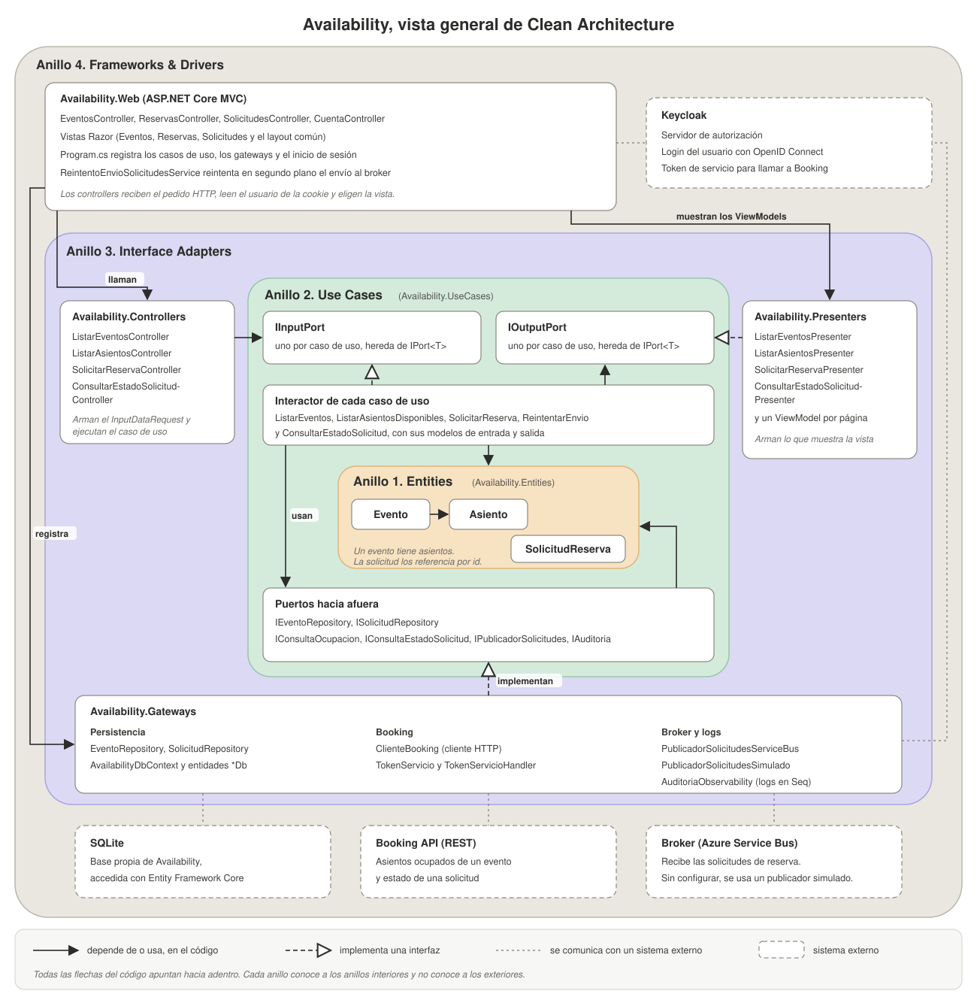

# Availability

## 1. Responsabilidad

Availability es el sitio web del sistema de reservas y el punto de entrada público que define el enunciado del trabajo práctico. Muestra los eventos y el mapa de asientos de cada uno, recibe la solicitud de reserva de un usuario con sesión iniciada y le muestra después el estado de esa solicitud.

Availability no decide si un asiento queda reservado. Esa decisión es de Booking, el servicio que administra las reservas y que cobra cada una por medio de Payment, el servicio de pagos. Availability consulta a Booking por REST para mostrar la ocupación y el estado de una solicitud, y le envía cada solicitud de reserva por Azure Service Bus, el broker de mensajes del sistema. El inicio de sesión lo resuelve Keycloak, el servidor de autorización del grupo.

## 2. Arquitectura

El enunciado pide que Availability siga Clean Architecture, que divide el código en cuatro capas concéntricas llamadas anillos, y que use un dominio anémico, es decir, entidades con propiedades y sin lógica. Cada anillo es un proyecto de .NET, salvo el anillo 3, que tiene tres.



| Anillo | Proyecto | Contenido |
|---|---|---|
| 1, Entities | `Availability.Entities` | Contiene las entidades `Evento`, `Asiento` y `SolicitudReserva`. |
| 2, Use Cases | `Availability.UseCases` | Contiene los cinco casos de uso y las interfaces que necesitan de afuera. |
| 3, Interface Adapters | `Availability.Controllers`, `Availability.Presenters` y `Availability.Gateways` | Contienen los controllers y los presenters de cada caso de uso, y las clases que implementan el acceso a la base, a Booking, al broker y a los logs. |
| 4, Frameworks & Drivers | `Availability.Web` | Contiene la aplicación ASP.NET Core MVC, con sus controllers web, sus vistas Razor, el servicio en segundo plano y `Program.cs`. |

Las dependencias entre proyectos siguen la regla de dependencia de Clean Architecture. Ningún proyecto depende de un anillo exterior. El anillo 2 define las interfaces que necesita y los anillos exteriores las implementan. `Availability.Web` referencia a `Controllers`, `Presenters` y `Gateways`, y por medio de ellos llega a `UseCases` y `Entities`, porque `Program.cs` registra los puertos de cada caso de uso y llama a `AddGateways`, que registra las clases de `Gateways`.

## 3. Organización en carpetas

```
src/Availability/
├── Availability.Entities/
│   ├── Eventos/                  Evento y Asiento
│   └── Solicitudes/              SolicitudReserva y EstadoEnvio
├── Availability.UseCases/
│   ├── Interfaces/               IPort y las interfaces hacia Booking, el broker y los logs
│   ├── Eventos/
│   │   ├── IEventoRepository.cs
│   │   ├── ListarEventos/
│   │   └── ListarAsientosDisponibles/
│   └── Solicitudes/
│       ├── ISolicitudRepository.cs
│       ├── SolicitarReserva/
│       ├── ReintentarEnvio/
│       └── ConsultarEstadoSolicitud/
├── Availability.Controllers/
│   ├── Eventos/
│   └── Solicitudes/
├── Availability.Presenters/
│   ├── Comun/                    FormatoFechas
│   ├── ListarEventos/
│   ├── ListarAsientosDisponibles/
│   ├── SolicitarReserva/
│   └── ConsultarEstadoSolicitud/
├── Availability.Gateways/
│   ├── Persistencia/             DbContext, entidades de la base, repositorios, migraciones y datos iniciales
│   ├── Booking/                  cliente HTTP de Booking y token de servicio
│   ├── Broker/                   publicadores de solicitudes
│   ├── Observabilidad/           adaptador de los logs de auditoría
│   └── DependencyInjection.cs
└── Availability.Web/
    ├── Controllers/
    ├── Servicios/                servicio en segundo plano que reintenta el envío
    ├── Views/
    ├── Program.cs
    └── appsettings.json
```

La carpeta de cada caso de uso dentro de `Availability.UseCases` tiene la misma forma. `Interactor.cs` está en la raíz de la carpeta, los puertos están en `Interfaces/` y los modelos están en `Models/`.

## 4. Responsabilidad de cada archivo

### Availability.Entities

- `Eventos/Evento.cs` representa un evento, con su nombre, su fecha y la lista de sus asientos.
- `Eventos/Asiento.cs` representa un asiento, con su fila y su número. No guarda si está ocupado, porque ese dato es de Booking.
- `Solicitudes/SolicitudReserva.cs` representa la petición de un usuario para reservar un asiento. Guarda los identificadores del evento, del asiento y del usuario, la fecha de la solicitud y su estado de envío.
- `Solicitudes/EstadoEnvio.cs` define si la solicitud ya salió hacia el broker (`Enviada`) o todavía espera su envío (`Pendiente`). Este estado no describe la reserva, porque el estado de la reserva lo mantiene Booking.

### Availability.UseCases

- `Interfaces/IPort.cs` es la interfaz genérica con el método `HandleAsync`, de la que heredan los puertos de entrada y de salida de los casos de uso.
- `Eventos/IEventoRepository.cs` y `Solicitudes/ISolicitudRepository.cs` definen cómo los casos de uso leen y guardan eventos y solicitudes, sin conocer la base. `ISolicitudRepository` también lista las solicitudes pendientes de envío y las marca como enviadas.
- `Interfaces/IConsultaOcupacion.cs` define la consulta de los asientos ocupados de un evento a Booking. `Interfaces/IConsultaEstadoSolicitud.cs` define la consulta del estado de una solicitud. Las dos devuelven `RespuestaOk = false` si Booking no responde, en lugar de lanzar una excepción.
- `Interfaces/IPublicadorSolicitudes.cs` define la publicación de una solicitud en el broker. Devuelve `false` si no se pudo confirmar el envío.
- `Interfaces/IAuditoria.cs` define el registro del inicio y del fin de cada caso de uso, y la asociación del `TraceId` a la operación.

Los cuatro casos de uso que atienden una página tienen cinco archivos con la misma función.

- `Interactor.cs` contiene la lógica del caso de uso. Recibe sus dependencias por el constructor y todas son interfaces de este anillo.
- `Interfaces/IInputPort.cs` es el puerto de entrada, la interfaz por la que el controller ejecuta el caso de uso.
- `Interfaces/IOutputPort.cs` es el puerto de salida, la interfaz por la que el caso de uso entrega su resultado al presenter.
- `Models/InputDataRequest.cs` contiene los datos de entrada del caso de uso.
- `Models/OutputDataResponse.cs` contiene el resultado, y los enums propios del caso de uso cuando los tiene.

`ReintentarEnvio` no atiende ninguna página, así que tiene solo `Interactor.cs`, `Interfaces/IInputPort.cs` y `Models/InputDataRequest.cs`, sin puerto de salida ni presenter.

| Caso de uso | Qué hace el `Interactor` |
|---|---|
| `ListarEventos` | Lee los eventos de la base y los entrega ordenados por fecha. No consulta a Booking. |
| `ListarAsientosDisponibles` | Lee el evento con sus asientos, le pide a Booking los asientos ocupados y calcula el estado de cada asiento. Si Booking no responde, marca todos los asientos como `Desconocido`. |
| `SolicitarReserva` | Verifica que el asiento exista en el evento, crea la solicitud con un identificador nuevo y la guarda como pendiente de envío. Después la publica en el broker sin esperar el resultado de Booking y, si el broker confirma, la marca como enviada. Si el broker no confirma, la solicitud queda guardada como pendiente. |
| `ReintentarEnvio` | Busca las solicitudes pendientes de envío registradas hace más de 90 segundos y las vuelve a publicar, de la más vieja a la más nueva, con el mismo `solicitudId`. Toma como máximo 50 por vuelta y marca como enviada cada una que el broker confirma. Se detiene en la primera que el broker no confirma, y si una solicitud lanza una excepción sigue con la siguiente. |
| `ConsultarEstadoSolicitud` | Busca la solicitud y verifica que sea del usuario que consulta. Si está pendiente de envío, informa ese estado sin consultar a Booking. Si ya se envió, le pide el estado a Booking y lo traduce al estado que muestra la página. |

### Availability.Controllers

- `Eventos/ListarEventosController.cs`, `Eventos/ListarAsientosController.cs`, `Solicitudes/SolicitarReservaController.cs` y `Solicitudes/ConsultarEstadoSolicitudController.cs` arman el `InputDataRequest` de su caso de uso, lo ejecutan por el `IInputPort` y devuelven el ViewModel, el objeto con los datos que muestra la vista, que dejó el presenter. Este proyecto no depende de ASP.NET Core.

### Availability.Presenters

- `ListarEventos/ListarEventosPresenter.cs`, `ListarAsientosDisponibles/ListarAsientosPresenter.cs`, `SolicitarReserva/SolicitarReservaPresenter.cs` y `ConsultarEstadoSolicitud/ConsultarEstadoSolicitudPresenter.cs` implementan el `IOutputPort` de su caso de uso. Reciben el `OutputDataResponse` y crean el ViewModel.
- Los archivos que terminan en `ViewModel.cs` contienen los datos que muestra cada vista, con los textos, las fechas y las clases CSS ya preparados. `SolicitudRecibidaViewModel.cs` es el ViewModel de la página que confirma que la solicitud quedó registrada, con un texto distinto si quedó pendiente de envío.
- `Comun/FormatoFechas.cs` convierte las fechas de UTC a la hora de Argentina y arma sus textos.

### Availability.Gateways

- `Persistencia/AvailabilityDbContext.cs` es el contexto de Entity Framework Core, con las tablas `Eventos`, `Asientos` y `Solicitudes`.
- `Persistencia/Entidades/EventoDb.cs`, `AsientoDb.cs` y `SolicitudReservaDb.cs` representan las filas de esas tablas. Son clases distintas de las entidades del anillo 1, porque las claves foráneas y las propiedades de navegación son detalles de la base.
- `Persistencia/Mapeos.cs` convierte las entidades de la base en entidades del anillo 1. Las solicitudes de reserva también las convierte en el sentido contrario, porque son lo único que Availability guarda.
- `Persistencia/Repositorios/EventoRepository.cs` y `SolicitudRepository.cs` implementan `IEventoRepository` e `ISolicitudRepository` con Entity Framework Core.
- `Persistencia/DatosIniciales.cs` carga los eventos y asientos de prueba, con identificadores fijos.
- `Persistencia/Migraciones/` contiene las migraciones de Entity Framework Core que crean la base.
- `Booking/ClienteBooking.cs` implementa `IConsultaOcupacion` e `IConsultaEstadoSolicitud` con un cliente HTTP que llama a la API REST de Booking.
- `Booking/TokenServicio.cs` le pide a Keycloak el token de servicio que Availability presenta ante Booking, lo guarda y lo renueva cuando está por vencer. `Booking/TokenServicioHandler.cs` agrega ese token a cada petición HTTP del cliente de Booking.
- `Booking/AsientosOcupadosResponse.cs` y `Booking/EstadoSolicitudResponse.cs` tienen la forma del JSON que responde Booking. `Booking/MapeosBooking.cs` los convierte en los modelos del anillo 2.
- `Booking/OpcionesBooking.cs` agrupa la dirección de Booking y los datos para pedir el token de servicio.
- `Broker/PublicadorSolicitudesServiceBus.cs` implementa `IPublicadorSolicitudes` con Azure Service Bus. Publica en el tópico del grupo un mensaje con el `solicitudId` como `MessageId` y `CorrelationId`, como pide el contrato del broker. Devuelve `false` si no logra publicarlo.
- `Broker/PublicadorSolicitudesSimulado.cs` implementa la misma interfaz sin enviar nada. Arma y serializa el mensaje y registra en el log el identificador de la solicitud. Se usa cuando la configuración no tiene el connection string de Service Bus. Si `Broker:SimularSinRespuesta` está activo, devuelve `false` como si el broker no respondiera, lo que sirve para probar el reintento.
- `Broker/SolicitudReservaMensaje.cs` tiene la forma del mensaje que se publica en el broker. `Broker/MapeosBroker.cs` lo arma a partir de una `SolicitudReserva`.
- `Observabilidad/AuditoriaObservability.cs` implementa `IAuditoria` con `Shared.Observability`, el proyecto de logs común del grupo.
- `DependencyInjection.cs` registra cada interfaz de este proyecto con la clase que la implementa, y elige el publicador real o el simulado según la configuración. Lo llama `Program.cs`.

### Availability.Web

- `Program.cs` configura los logs, el inicio de sesión con Keycloak, los gateways, el `Interactor`, el controller y el presenter de cada caso de uso, y el servicio en segundo plano. También arma la cadena de pasos por los que pasa cada petición HTTP.
- `Controllers/EventosController.cs` atiende la lista de eventos y el mapa de asientos. Las dos páginas son públicas.
- `Controllers/ReservasController.cs` recibe la solicitud de reserva y muestra la página de solicitud registrada. Pide la sesión iniciada.
- `Controllers/SolicitudesController.cs` muestra el estado de una solicitud. Pide la sesión iniciada.
- `Controllers/CuentaController.cs` inicia y cierra la sesión con Keycloak.
- `Servicios/ReintentoEnvioSolicitudesService.cs` ejecuta el caso de uso `ReintentarEnvio` cada 15 segundos mientras la aplicación está en marcha.
- `Views/` contiene las vistas Razor de cada página y el layout común.
- `appsettings.json` contiene la configuración que no es secreta, como la dirección de Keycloak y la de Booking. El secret del client de Keycloak y el connection string de Service Bus se guardan en User Secrets.

## 5. Flujo de datos

Al arrancar, `Program.cs` registra los servicios. En el entorno de desarrollo también llama a `AplicarMigraciones`, de `DependencyInjection`, que crea la base SQLite y aplica las migraciones pendientes, con los datos iniciales incluidos. Después arranca el servicio en segundo plano, y Availability atiende la lista de eventos, el mapa de asientos, la solicitud de reserva y el seguimiento de una solicitud.

### Recorrido de la lista de eventos

El usuario entra a la página de inicio. `EventosController` llama a `ListarEventosController`, que ejecuta el caso de uso. El `Interactor` lee los eventos con `EventoRepository` y se los entrega a `ListarEventosPresenter`, que arma el ViewModel. La vista muestra la lista.

### Recorrido del mapa de asientos

El usuario elige un evento. El `Interactor` de `ListarAsientosDisponibles` lee el evento con sus asientos y le pide a `ClienteBooking` los asientos ocupados. `ClienteBooking` llama al endpoint de asientos ocupados de Booking, y `TokenServicioHandler` agrega a esa petición el token de servicio que `TokenServicio` obtuvo de Keycloak. El `Interactor` calcula el estado de cada asiento y la vista muestra el mapa. Si Booking no responde, el mapa se muestra igual, con un aviso y los asientos sin estado.

### Recorrido de la solicitud de reserva

El usuario elige un asiento y confirma. Si no tiene sesión, ASP.NET Core lo manda a iniciar sesión en Keycloak. `ReservasController` toma el identificador del usuario del claim `sub`, el dato del token que identifica al usuario, y ejecuta el caso de uso. El `Interactor` verifica que el asiento exista en el evento, crea la solicitud, la guarda como pendiente de envío con `SolicitudRepository` y la publica con `IPublicadorSolicitudes`. Si el broker confirma, la marca como enviada. Availability responde sin esperar a Booking, y el navegador pasa a la página de solicitud registrada, que muestra el número de la solicitud. Si no hay confirmación, la página avisa que la solicitud quedó registrada y que se enviará cuando el broker responda.

### Recorrido del reintento de envío

Este recorrido aplica el patrón Outbox, en el que la solicitud se guarda siempre en la base de Availability antes de publicarse. `SolicitarReserva` la publica en la misma petición y, si el broker no confirma, un proceso aparte la reenvía cuando el broker responde. Cada 15 segundos, `ReintentoEnvioSolicitudesService` ejecuta el caso de uso `ReintentarEnvio`, que vuelve a publicar las solicitudes pendientes. Un timeout no prueba que el broker haya rechazado el mensaje, así que el mensaje puede llegar dos veces. El reenvío conserva el mismo `solicitudId` en el cuerpo y en el `MessageId`, y Booking usa ese identificador para no procesar dos veces la misma solicitud.

### Recorrido del seguimiento de una solicitud

El usuario abre la página de su solicitud. El `Interactor` de `ConsultarEstadoSolicitud` busca la solicitud y verifica que sea del usuario. Si no existe o es de otro usuario, la página informa que no se encontró y no se consulta a Booking. Si está pendiente de envío, la página la muestra así, sin consultar a Booking. Si ya se envió, `ClienteBooking` llama al endpoint de estado de Booking. Un 404 significa que Booking todavía no procesó la solicitud, y la página la muestra en proceso.

Cada recorrido registra su inicio y su fin en los logs de auditoría.

## 6. Contratos

- `contracts/availability-booking.md` define los dos endpoints REST de Booking que usa Availability, el de los asientos ocupados de un evento y el del estado de una solicitud.
- `contracts/broker.md` define el mensaje de solicitud que Availability publica para Booking. Tiene cinco campos en JSON (`solicitudId`, `eventoId`, `asientoId`, `usuarioId` y `fechaSolicitud`), y el `solicitudId` es también el `MessageId` del mensaje.
- `contracts/tokens.md` define el token de servicio. Availability lo pide a Keycloak con su client `availability-web` y el scope `booking-api`, y lo envía a Booking en cada petición.
- `contracts/logs.md` define el formato de los logs de auditoría y el `TraceId`, el identificador que comparten los logs de todas las operaciones de una misma solicitud en los distintos servicios.

## 7. Persistencia

Availability usa una base SQLite propia, el archivo `availability.db`, con Entity Framework Core.

| Tabla | Contenido |
|---|---|
| `Eventos` | Guarda los eventos, con su nombre y su fecha. |
| `Asientos` | Guarda los asientos de cada evento. Un índice único impide repetir la misma fila y número en un evento. |
| `Solicitudes` | Guarda las solicitudes de reserva, con el evento, el asiento, el usuario, la fecha y el estado de envío. Un índice sobre el estado de envío permite encontrar las pendientes sin recorrer toda la tabla. Tiene también un índice por usuario para listar las solicitudes de cada uno, que hoy ninguna consulta usa, porque el seguimiento busca por identificador de solicitud. |

La base no guarda el estado de las reservas, porque ese dato es de Booking. Los datos iniciales tienen tres eventos, de 50, 24 y 24 asientos.

## 8. Auditoría

Los casos de uso registran el inicio y el fin de su operación con `IAuditoria`. El adaptador `AuditoriaObservability` implementa esa interfaz con `Shared.Observability`, que escribe los logs en la consola y en Seq, la herramienta donde se consultan los logs. Los casos de uso no usan `Shared.Observability` directamente, porque ese proyecto depende de ASP.NET Core, y la regla de dependencia de Clean Architecture solo permite que el anillo 2 dependa del anillo 1.

| Operación | `TraceId` | Resultados posibles |
|---|---|---|
| `listar_eventos` | Es el `TraceId` de la petición HTTP. | Termina en `ok` o en `error`. |
| `listar_asientos` | Es el `TraceId` de la petición HTTP, que `ClienteBooking` envía a Booking en el header `X-Trace-Id`. | Termina en `ok`, en `ok` con el motivo `ocupacion_no_disponible`, en `rechazada` con `evento_inexistente` o en `error`. |
| `solicitar_reserva` | Es el `solicitudId`. | Termina en `ok`, en `rechazada` con `asiento_inexistente` o en `error` con `broker_no_disponible`, y en ese caso la solicitud queda pendiente de envío. |
| `reintentar_envio` | Es el `solicitudId` de la solicitud que se reenvía. | Termina en `ok` cuando el broker confirma, o en `error` con `broker_no_disponible` si la solicitud sigue pendiente. |
| `consultar_solicitud` | Es el `solicitudId` consultado. | Termina en `ok`, en `rechazada` con `solicitud_inexistente` o en `error` con `booking_no_disponible`. |

Además, cualquier operación que lanza una excepción registra su fin con `error` y el motivo `excepcion`. En la solicitud de reserva, el reintento y el seguimiento, el `TraceId` es el `solicitudId`, el mismo identificador que viaja en el mensaje del broker, así que los logs de Availability, Booking y Payment sobre una misma solicitud se pueden unir.
