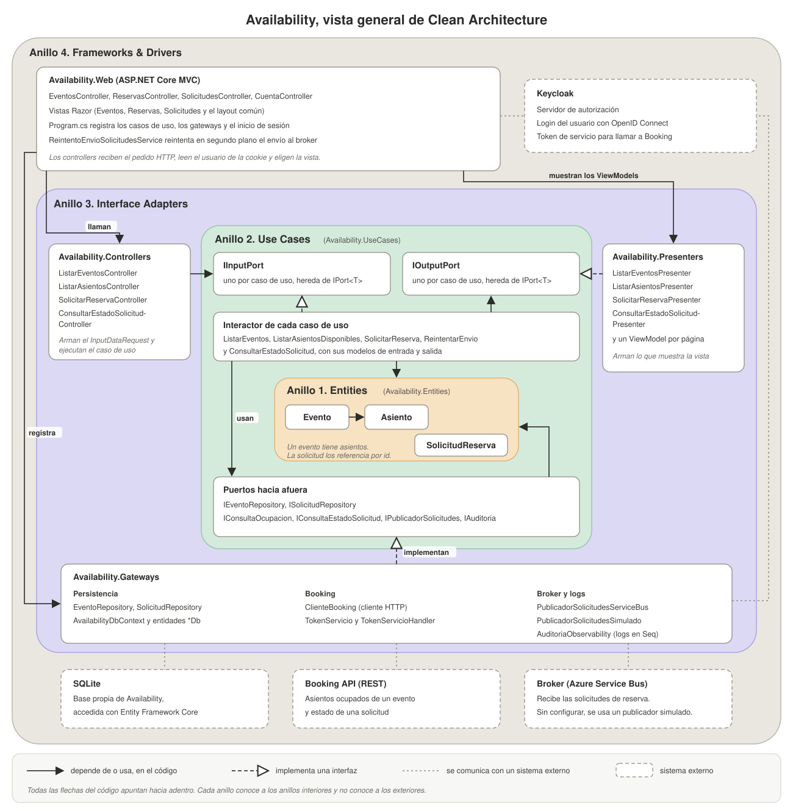

# Arquitectura del servicio Availability

Availability es el sitio web del sistema de reservas y el punto de entrada público que define el enunciado. Muestra los eventos y el mapa de asientos de cada uno, recibe la solicitud de reserva de un usuario con sesión iniciada y le muestra después el estado de esa solicitud. Para eso consulta a Booking, el servicio que administra las reservas, y publica cada solicitud en un broker, un intermediario de mensajes que se la entrega a Booking. El inicio de sesión lo resuelve Keycloak, el servidor de autorización del grupo.

El enunciado pide que Availability siga Clean Architecture, que divide el código en cuatro capas concéntricas llamadas anillos, y que use un dominio anémico, es decir, entidades con propiedades y sin lógica.

## Diagrama de clases de Availability

El diagrama dibuja los cuatro anillos uno dentro de otro, con Entities en el centro. Cada caja agrupa clases o interfaces de un mismo proyecto, sin sus atributos, y las flechas indican las relaciones principales entre los grupos.

- En el anillo 1, Entities, están las entidades `Evento`, `Asiento` y `SolicitudReserva`. Contienen solo propiedades, sin métodos ni validaciones.
- En el anillo 2, Use Cases, están los casos de uso `ListarEventos`, `ListarAsientosDisponibles`, `SolicitarReserva` y `ConsultarEstadoSolicitud`. Cada uno tiene un `Interactor`, la clase que ejecuta el caso de uso, un puerto de entrada (`IInputPort`), que es la interfaz que llaman los controllers, y un puerto de salida (`IOutputPort`), que es la interfaz por la que el caso de uso entrega su resultado. Este anillo también define las interfaces que los casos de uso usan para acceder a la base, consultar a Booking y publicar en el broker.
- En el anillo 3, Interface Adapters, están los controllers del proyecto `Availability.Controllers`, que ejecutan cada caso de uso, los presenters, que arman el ViewModel con los datos de cada página, y los gateways. Los gateways son las clases que implementan las interfaces hacia afuera del anillo 2. Para la base usan Entity Framework Core y SQLite. Para Booking usan un cliente HTTP que envía un token de servicio, una credencial de la aplicación que emite Keycloak. Para el broker usan un publicador que hoy es simulado.
- En el anillo 4, Frameworks & Drivers, está `Availability.Web`, la aplicación ASP.NET Core MVC con sus propios controllers, que reciben el pedido HTTP, sus vistas Razor y `Program.cs`. En el mismo anillo, con borde punteado, están los sistemas externos con los que se comunica Availability, que son Keycloak, la base SQLite, la API de Booking y Azure Service Bus. Mientras no esté el publicador real, Azure Service Bus queda reemplazado por el publicador simulado.

Las flechas continuas representan dependencias en el código y ninguna apunta hacia un anillo exterior. Cada anillo depende solo de los anillos interiores. Las flechas punteadas con triángulo indican qué clases implementan cada interfaz del anillo 2. Cada `Interactor` implementa el puerto de entrada de su caso de uso, los presenters implementan el puerto de salida y los gateways implementan las interfaces hacia la base, Booking y el broker. Las líneas grises punteadas unen Availability con los sistemas externos.
