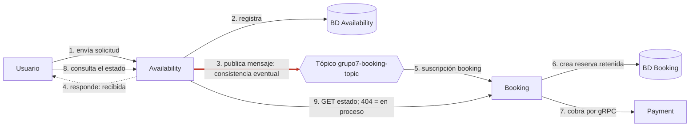

# Flujo del mensaje del broker: punto de consistencia eventual

Este diagrama muestra el recorrido completo de una solicitud de reserva y destaca el **punto de consistencia eventual**: la flecha **3** es el momento donde Availability deja de esperar (publica el mensaje y confirma "recibida" al usuario sin saber todavía si Booking la procesa), porque la solicitud ya quedó guardada en su base. El **estado 404 del paso 9** es la traducción de ese hueco: mientras el mensaje no llegue a Booking, el endpoint 2 del contrato REST responde `404 Not Found`, y Availability lo interpreta como "en proceso" (`contracts/availability-booking.md:157`). Los pasos restantes (retención, cobro y consulta) ya están alineados con el contrato del mensaje (`contracts/broker.md`) y el contrato REST (`contracts/availability-booking.md`).

